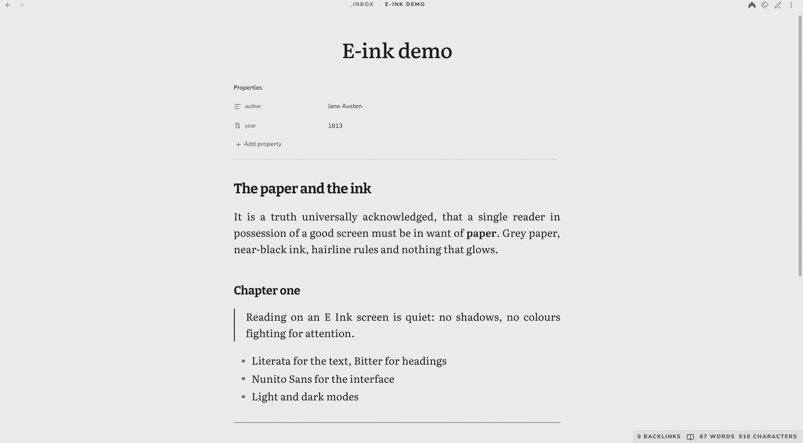
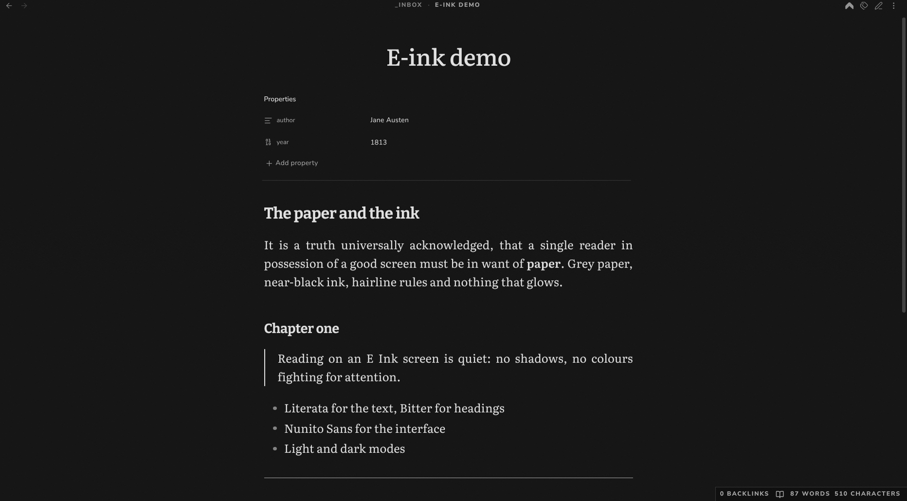

# E-ink

A calm reading theme for Obsidian that looks like an E Ink screen: neutral grey paper, near-black ink, hairline rules instead of shadows, and no animations.

## Features

- Light and dark modes.
- Literata for the text (17px, line height 1.6), Bitter for headings, Nunito Sans for the interface.
- No shadows or depth: hairline borders, a plain property list and a hairline thematic break.
- Running header and footer in spaced small caps.
- Instant refresh: transitions are turned off, like turning a page on an e-reader.
- Works offline: the fonts are embedded in the theme, so it makes no network requests.

## Installation

In Obsidian, open **Settings → Appearance → Themes → Manage**, search for **E-ink**, then select **Install and use**.

## License

[MIT](./LICENSE). The embedded fonts Literata, Nunito Sans and Bitter are licensed under the [SIL Open Font License 1.1](./OFL.txt).
